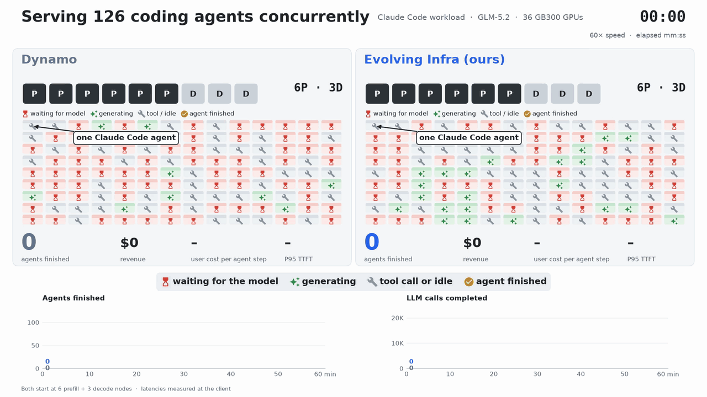
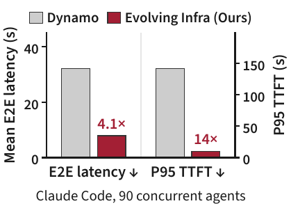

<p align="center">
  
</p>

<h1 align="center">Evolving Infra</h1>

<h3 align="center">
Agent-Adaptive LLM Serving at Scale
</h3>

<p align="center">
  
  <a href="https://inference-rsi.com/"></a>
  <a href="docs/README.md"></a>
  <a href="https://huggingface.co/datasets/crmsndu/evolving-infra-traces"></a>
  <a href="LICENSE"></a>
</p>

---

## About

<p align="center">
  <a href="https://github.com/user-attachments/assets/2b72a963-857f-4afe-88b8-765a065a0494"></a>
</p>

Evolving Infra is an LLM serving system for agent workloads. While it runs, it adjusts how the
GPUs are split between prefill and decode, and which KV cache it keeps, to fit the agents it
serves. Serving coding, math and computer-use agents with GLM-5.2 and Kimi K2.6 on up to 256
GB300 GPUs, it reduces mean end-to-end latency by up to **4.1×** and P95 time to first token by
up to **14×** compared with [NVIDIA Dynamo](https://github.com/ai-dynamo/dynamo), with up to
**2.7×** its throughput.

- **Every node runs prefill and decode.** A node switches between the two in seconds, without a
  restart. KV stays in a host-memory pool that every node can read, so a node keeps its cache
  when it switches.
- **The planner follows the workload.** It learns how long prefill and decode steps take while
  serving, and changes the prefill/decode split only when the gain lasts.
- **The KV cache follows the agents.** The router counts how many agent branches (an agent or one
  of its sub-agents) still use each KV block. Blocks that no branch uses, such as histories
  replaced by compaction and the context of finished sub-agents, are evicted first.
- **The router places requests by predicted wait.** It sends each prefill to the node with the
  shortest predicted time to first token, and fetches cached KV from other nodes while the
  request waits.

Agents connect through an OpenAI-compatible API with one extra header. The engine (derived from
[SGLang](https://github.com/sgl-project/sglang)), the Rust router, the planner and a replay client
for agent traces build into one image, and run DeepSeek-V4-Flash, GLM-5.2 and Kimi-K2.6 on NVIDIA
H200, B300 and GB300 ([models and hardware](docs/README.md#models-and-hardware)).

### Overview

<p align="center">
  
</p>

The router sends each request to a prefill node and a decode node. The planner moves nodes
between the two groups (dashed arrow). KV stays in shared host memory while an agent branch still
uses it. [Architecture](docs/architecture.md) describes the request path.

### Results

Evolving Infra lowers latency against Dynamo on every workload in the paper. Below: Claude Code
traces, 90 concurrent agents.

<p align="center">
  
</p>

## Getting Started

Build the image, which has every component:

```bash
git clone https://github.com/crmsndu/evolving-infra.git
cd evolving-infra
docker build -f docker/Dockerfile -t evolving-infra .
```

Or install from source:

```bash
pip install -e engine                                   # engine
pip install -e ".[client,frontend,indexer,planner]"     # client, tokenizer service, KV directory, planner
(cd router/core && cargo build --release --locked)      # router
```

[Quickstart](docs/quickstart.md) starts the stack on one 8-GPU node.
[Quickstart on GB300](docs/quickstart-gb300.md) runs the paper's configuration on two GB300 nodes.

To connect an agent, point its OpenAI client at the router and tag each request with the agent
and branch it belongs to:

```python
client = openai.OpenAI(base_url="http://localhost:30900/v1", api_key="unused")
identity = {"agent_id": "task-42", "subagent_id": 0, "request_id": 7}
client.completions.create(
    model="glm-5.2", prompt=prompt, max_tokens=1024,
    extra_headers={"x-agent-context": json.dumps(identity)},
)
```

`subagent_id` names the branch and `request_id` the request's position in it.

## Repository layout

| Directory | What it contains |
|---|---|
| [`engine/`](engine/README.md) | Serving engine, derived from SGLang (`decoupled_engine`) |
| [`router/core/`](router/core/README.md) | Rust router (`sgl-router`) |
| [`router/frontend/`](router/frontend/README.md), [`router/indexer/`](router/indexer/README.md), [`router/client/`](router/client/__init__.py) | Tokenizer service, KV directory, Python client |
| [`planner/`](planner/README.md) | Planner |
| [`benchmarks/`](benchmarks/README.md) | Agent trace replay, run checks, reference results |
| [`deploy/modal/`](deploy/modal/README.md), [`docker/`](docker/README.md) | Benchmarks on Modal, runtime image |

## Contributing

We welcome contributions. Please open an issue or a pull request.

## Citation

The paper is coming soon; a BibTeX entry will be added here.

## License

Apache License 2.0 ([LICENSE](LICENSE)). The engine and the router core are derived from SGLang
at upstream commit `9a489f8d2f`; [NOTICE](NOTICE) lists every included third-party work.
