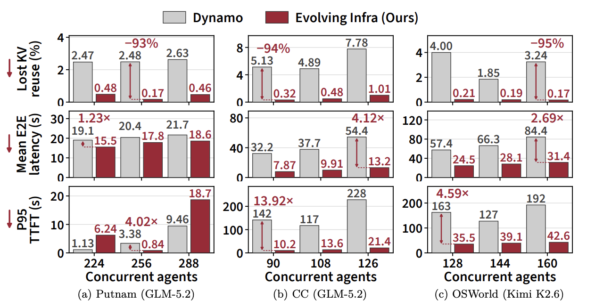
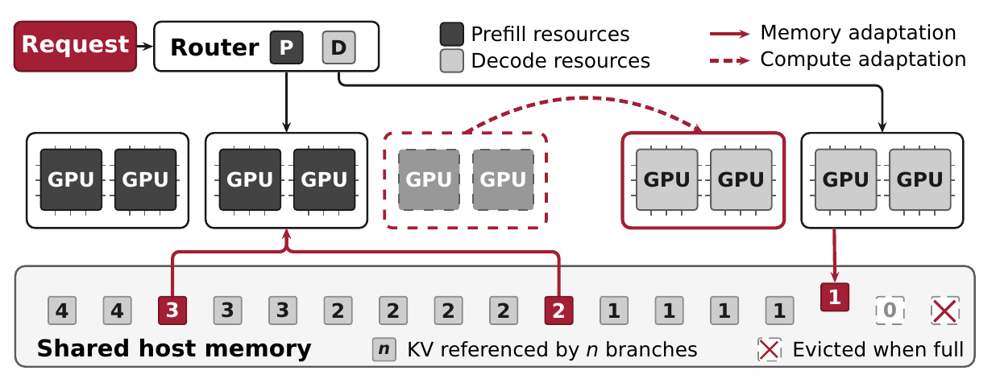
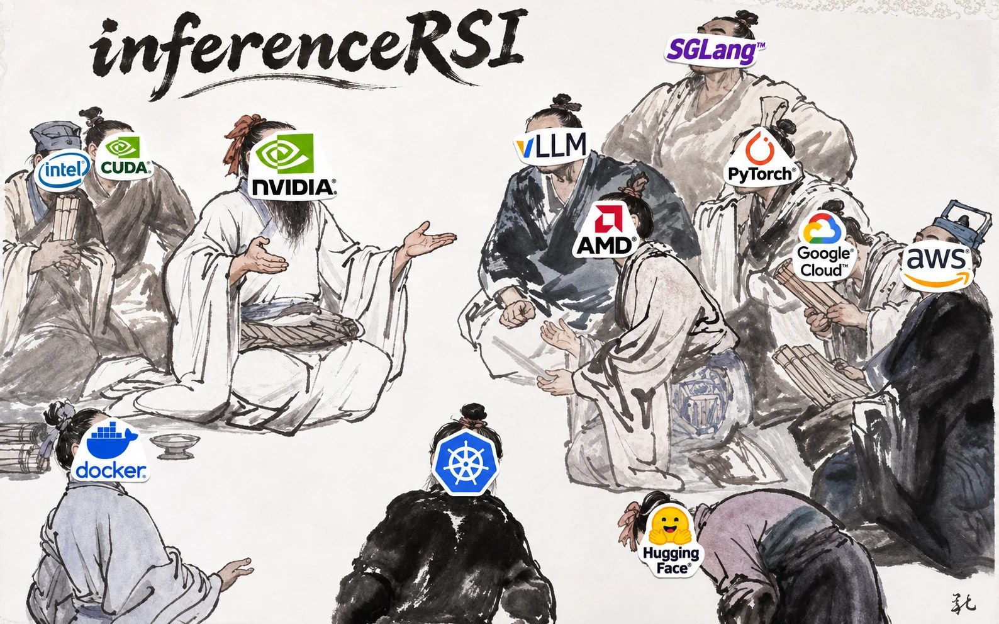

<p align="center">
  
</p>

<h1 align="center">Evolving Infra</h1>

<h3 align="center">
Agent-Adaptive LLM Serving at Scale
</h3>

<p align="center">
  
  <br><sub>Corresponding author: <a href="mailto:hao.kang.sys@gmail.com">hao.kang.sys@gmail.com</a></sub>
</p>

<p align="center">
| <a href="https://inference-rsi.com/"><b>Website</b></a> | <a href="https://arxiv.org/abs/2611.12304"><b>Paper</b></a> | <b>Wiki</b> (coming soon) |
</p>

<p align="center">
  <a href="https://inference-rsi.com/"></a>
  <a href="https://arxiv.org/abs/2611.12304"></a>
  <a href="docs/README.md"></a>
  <a href="https://huggingface.co/datasets/crmsndu/evolving-infra-traces"></a>
  <a href="LICENSE"></a>
</p>

---

https://github.com/user-attachments/assets/2e0dc016-da36-4f72-b33c-9f7122214ebe

Evolving Infra is an LLM serving system that adapts itself to the agent workload **purely online**,
with **no offline profiling**. Serving coding, math and computer-use agents with GLM-5.2 and Kimi K2.6
on up to 256 GB300 GPUs, it reduces mean end-to-end latency by up to **4.1×** and P95 time to
first token by up to **14×** compared with [NVIDIA Dynamo](https://github.com/ai-dynamo/dynamo),
with up to **2.7×** its throughput.

<p align="center">
  
  <br><sub>Math (Putnam), coding (Claude Code) and computer-use (OSWorld) agents, three concurrency levels each. Lower is better.</sub>
</p>

## About

Evolving Infra adapts online through three designs:

1. **Decouple** compute allocation from KV cache management, so online adaptation is cheap: a node
   switches between prefill and decode **in seconds, without a restart**, and its KV cache stays in
   a host-memory pool that every node can read.
2. **Predict** the prefill and decode load of agents with a **cost model** that covers
   **sub-agents and context management**. The planner uses it to match the prefill/decode split to
   the workload, and the router to place each request.
3. **Manage KV** with an **agent-aware distributed KV manager**: signals from agent context
   management drive KV transfer and eviction, so it **evicts** the KV that no agent branch needs,
   such as histories replaced by compaction and the context of finished sub-agents, and **keeps**
   the KV that agents will reuse.

### Overview

<p align="center">
  
</p>

The router sends each request to a prefill node and a decode node. The planner moves nodes
between the two groups (dashed arrow). KV stays in shared host memory while an agent branch still
uses it. [Architecture](docs/architecture.md) describes the request path.

## Getting Started

Evolving Infra runs DeepSeek-V4-Flash, GLM-5.2 and Kimi-K2.6 on NVIDIA H200, B300 and GB300
([models and hardware](docs/README.md#models-and-hardware)). The runtime image has every
component. Pull the prebuilt image (x86_64 for H200 and B300, aarch64 for GB300):

```bash
docker pull docker.io/weili0234/evolving-infra:v0.1.0
```

or build it:

```bash
git clone https://github.com/mit-han-lab/EvolvingInfra.git
cd EvolvingInfra
docker build -f docker/Dockerfile -t evolving-infra .
```

Or install from source:

```bash
pip install -e evolving_infra/engine                                # engine
pip install -e ".[client,frontend,indexer,planner]"                 # launcher, client, tokenizer service, KV directory, planner
(cd evolving_infra/router/core && cargo build --release --locked)   # router
```

To reproduce the paper's setup, GLM-5.2 on GB300, start it on one node:

```bash
evolving-infra serve --config examples/gb300/glm52-1node.yaml
```

The node's GPUs become one prefill and one decode worker, and the router serves an
OpenAI-compatible API on port 30900. To run the paper's experiment on nine GB300 nodes with Slurm:

```bash
python examples/slurm/submit.py --account <account> --partition <partition> --image <image>
```

It serves, replays the Claude Code workload and writes the score
([examples/gb300](examples/gb300/README.md)). [Quickstart](docs/quickstart.md) starts each
component by hand.

For another model, GPU or cluster, give your coding agent the
[`serve`](skills/serve/SKILL.md) skill: "serve `<model>` on these hosts with Evolving Infra,
following `skills/serve/SKILL.md`". It inspects the machines, derives the config for the
model, starts the stack and checks that it answers. The other skills run the benchmark
([`run-benchmark`](skills/run-benchmark/SKILL.md)) and find why a run failed or is slow
([`debug-run`](skills/debug-run/SKILL.md)).

To connect an agent, point its OpenAI client at the router and tag each request with the agent
and branch it belongs to:

```python
client = openai.OpenAI(base_url="http://localhost:30900/v1", api_key="unused")
identity = {"agent_id": "task-42", "subagent_id": 0, "request_id": 7}
client.completions.create(
    model="glm-5.2", prompt=prompt, max_tokens=1024,
    extra_headers={"x-agent-context": json.dumps(identity)},
)
```

`subagent_id` names the branch and `request_id` the request's position in it.

## Repository layout

| Directory | What it contains |
|---|---|
| [`evolving_infra/engine/`](evolving_infra/engine/README.md) | Serving engine, derived from SGLang (`decoupled_engine`); [what we changed](evolving_infra/engine/CHANGES.md) |
| [`evolving_infra/router/core/`](evolving_infra/router/core/README.md) | Rust router (`sgl-router`) |
| [`evolving_infra/router/frontend/`](evolving_infra/router/frontend/README.md), [`evolving_infra/router/indexer/`](evolving_infra/router/indexer/README.md), [`evolving_infra/router/client/`](evolving_infra/router/client/__init__.py) | Tokenizer service, KV directory, Python client |
| [`evolving_infra/planner/`](evolving_infra/planner/README.md) | Planner |
| [`evolving_infra/launch/`](evolving_infra/launch/__main__.py), [`examples/`](examples/README.md) | `evolving-infra serve`; a config per hardware and model, and how to run one under Slurm or on Modal |
| [`AGENTS.md`](AGENTS.md), [`skills/`](skills/) | Instructions and skills for coding agents |
| [`benchmarks/`](benchmarks/README.md) | Agent trace replay, run checks, reference results |
| [`docker/`](docker/README.md) | Runtime image |

## Contributing

<p align="center"></p>

We welcome contributions, and we recommend making them with a coding agent:

- Use Claude Opus 5.5, GPT-6 Astra or a stronger model.
- Point the agent at [`AGENTS.md`](AGENTS.md): the contribution rules, the repository map and
  the commands to build and test.
- Before opening a pull request, have the agent run the
  [`pr-checklist`](skills/pr-checklist/SKILL.md) skill. It checks the change and fills
  the pull request template: claims, the evidence for each, and the root cause of a fix.
- Attach the agent's session transcript to your pull request, so
  reviewers can see how the change was made and checked. Scrub it first:
  `python tools/scrub_transcript.py <session file>` replaces tokens, e-mail addresses, home
  directories and the names you give it, and reports any string that still looks like a secret.
- For a larger change, open an issue first.

### Community

Join the InferenceRSI WeChat group to discuss the project:

<p align="center"></p>

## Citation

If you use Evolving Infra, please cite the [paper](https://arxiv.org/abs/2611.12304):

```bibtex
@misc{kang2026evolvinginfraagentadaptivellm,
  title={Evolving Infra: Agent-Adaptive LLM Serving at Scale},
  author={Hao Kang and Weili Xu and Ziyang Li and Zheng Du and Hanchen Li and Tian Xia and Song Bian and Tushar Krishna and Huizi Mao and Ion Stoica and Song Han},
  year={2026},
  eprint={2611.12304},
  archivePrefix={arXiv},
  primaryClass={cs.DC},
  url={https://arxiv.org/abs/2611.12304},
}
```

## License

Apache License 2.0 ([LICENSE](LICENSE)). The engine and the router core are derived from SGLang
at upstream commit `9a489f8d2f`; [NOTICE](NOTICE) lists every included third-party work.
