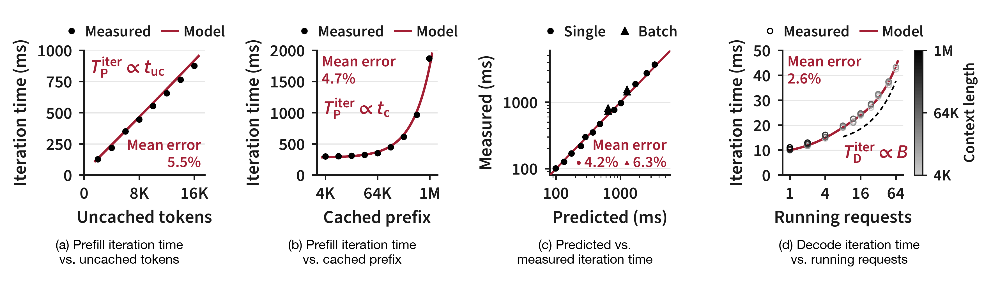
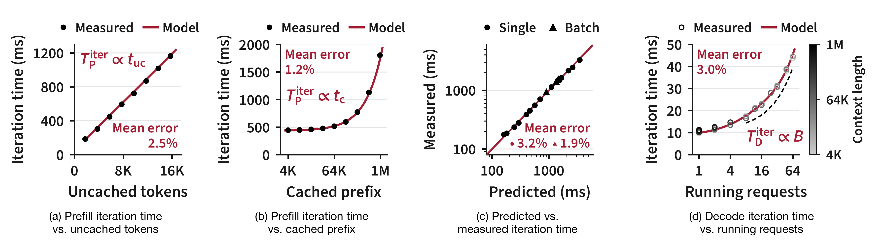

# Planner

`evolving_infra.planner` adapts the prefill/decode split of a fixed set of
symmetric workers while the service runs. It never restarts an engine: a role
change is one Router role assignment.

```bash
pip install -e ".[planner]"          # numpy, scipy
python -m evolving_infra.planner control --help
```

How to run it, and every launch parameter: [docs/dynamic-pd.md](../../docs/dynamic-pd.md).

## How it works

The planner follows Section 5 of the paper: it learns an iteration-time model of every worker
while serving, and from these models it predicts how many requests each prefill/decode split
completes per second. It switches only when another split is better on most of the recent
workload, not on a short burst.

### The work of a request

The router counts the work of every completed request:

| Symbol | Meaning |
|---|---|
| $t_{\mathrm{uc}}$, $t_{\mathrm{c}}$ | Uncached and cached prefill tokens |
| $t_{\mathrm{out}}$, $t_{\mathrm{acc}}$ | Output tokens; mean accepted tokens per decode iteration (above one under speculative decoding) |
| $w$ | Work of a request, $(t_{\mathrm{uc}}, t_{\mathrm{c}}, t_{\mathrm{out}}, t_{\mathrm{acc}})$ |
| $B$ | Running requests on a decode worker |

The planner reads these counts, and the number of requests in decode, from the router every
3 seconds (`--router-poll-interval-secs`).

### Iteration-time models

A worker runs its requests in iterations, each one forward pass. The kernels of an iteration run
one after another, and each is limited either by compute or by memory bandwidth.

**Prefill** is compute-bound. The linear layers take time in proportion to the new tokens, and
attention in proportion to the query–key pairs: a request with $t_{\mathrm{uc}}$ new tokens after
$t_{\mathrm{c}}$ cached ones computes $A = t_{\mathrm{uc}} t_{\mathrm{c}} + t_{\mathrm{uc}}(t_{\mathrm{uc}}+1)/2$
pairs. Restoring a cached prefix from host memory takes time in proportion to the restored tokens
$t_{\mathrm{rst}}$, and every iteration pays a fixed cost. A prefill iteration on worker $n$ takes

$$T^{\mathrm{iter}}_{\mathrm{P},n} = c_{n,0} + c_{n,1} \sum t_{\mathrm{uc}} + c_{n,2} \sum A + c_{n,3} \sum t_{\mathrm{rst}},$$

summed over the requests of the batch. When requests carry images, a fifth term adds the
vision encoder's work.

**Decode** is memory-bound, and most of the bytes it reads are weights. Every iteration reads the
dense weights in full; a mixture-of-experts layer reads only the experts that its tokens select.
Each of the $B$ running requests feeds $t_{\mathrm{fwd}}$ tokens into the iteration (the draft
tokens under speculative decoding), and with each token selecting $k$ of $E$ routed experts, they
select an expected fraction $\phi(B) = 1 - (1 - k/E)^{t_{\mathrm{fwd}} B}$ of them. Each running
request also adds about the same time, for example to sample and to draft. A decode iteration on
worker $n$ takes

$$T^{\mathrm{iter}}_{\mathrm{D},n}(B) = d_{n,0} + d_{n,1}\,\phi(B) + d_{n,2}\, B .$$

The model leaves out the context length: at 8 or more running requests it changes the iteration
time by at most 7% on the models below. The planner reads $E$ and $k$ from the engine's
`/model_info` and $t_{\mathrm{fwd}}$ from the traces.

### From iteration time to requests per second

A prefill request pays its own share of every term, plus a share of the fixed cost in proportion
to its new tokens. With $\bar{t}_n$ the mean new tokens per prefill iteration of worker $n$ and
$f_n$ the fraction of cached tokens it restores from host memory, a request occupies the worker for

$$T^{\mathrm{req}}_{\mathrm{P},n}(w) = c_{n,0}\, t_{\mathrm{uc}}/\bar{t}_n + c_{n,1}\, t_{\mathrm{uc}} + c_{n,2}\, A + c_{n,3}\, f_n\, t_{\mathrm{c}} .$$

In decode, the $B$ running requests share each iteration, which advances each by $t_{\mathrm{acc}}$
tokens, so a request occupies the worker for

$$T^{\mathrm{req}}_{\mathrm{D},n}(w) = T^{\mathrm{iter}}_{\mathrm{D},n}(B)\, t_{\mathrm{out}} / (B\, t_{\mathrm{acc}}) .$$

Worker $n$ completes $\mu_{\mathrm{P},n} = 1/T^{\mathrm{req}}_{\mathrm{P},n}$ prefill requests or
$\mu_{\mathrm{D},n} = 1/T^{\mathrm{req}}_{\mathrm{D},n}$ decode requests per second. The decode
batch $B$ is the number of requests in decode divided by the decode workers, capped by the
engine's `max_running_requests` and by 95% of the worker's KV capacity divided by the mean context.
A decode worker with less than one request on average counts as busy for only that share of the
time. The router spreads decode evenly, so the decode capacity is the number of decode workers
times the slowest one.

### Learning the models while serving

1. **Cold start.** From the first completed request, the planner computes for every 60-second
   slice (`--slice-secs`) the share of input tokens served from cache. The cold start is over when
   a slice's share is at most 0.3 percentage points above the previous slice's
   (`--cold-start-stable-change`): the share has stopped rising. A slice with no cache hit does
   not count. Learning starts
   anyway 1800 seconds after the first completed request (`--cold-start-max-wait-secs`).
2. **Learning** (1800 seconds, `--learning-secs`). Every worker serves in its initial role. The
   planner copies the engines' scheduler traces from each host's trace server, checks the host
   clocks, and reads the prefill workers' restored-token counters.
3. **Fit.** At the end of learning the planner fits every worker once by nonnegative least
   squares, and then keeps the coefficients fixed. The prefill model is fitted on 60-second
   windows (the slice length) of each prefill worker: the busy time of a window against the sums
   of its terms, which keeps the same coefficients because the model is linear. The decode model
   is fitted on groups of 8 consecutive iterations. The first 70% of the interval trains the
   model and the last 30% measures its error (`<run_dir>/calibration/report.json`); the final
   coefficients use all of it. A prefill worker with too few windows, or whose windows cannot
   separate the terms, keeps the predeclared shape (`--prefill-shape-prior`) and fits one
   multiplier. A worker that never served a role uses the
   median prediction of the workers that did.
4. **Before every decision** the planner measures $\bar{t}_n$ and $f_n$ of the current prefill
   workers again, on 60-second windows of the last interval, because they change with the
   workload and with request placement.

### Choosing the split

Every 600 seconds (`--decision-period-secs`), the planner compares the splits. Every request
passes through both phases, so the slower phase sets the throughput:

$$\Theta(\mathcal{P}, \mathcal{D}; \bar{w}, \bar{q}) = \min\Bigl( \sum_{n\in\mathcal{P}} \mu_{\mathrm{P},n},\; \sum_{n\in\mathcal{D}} \mu_{\mathrm{D},n} \Bigr),$$

where $\bar{w}$ is the mean work of a request and $\bar{q}$ the mean number of requests in decode.
For every prefill count other than the current one, the planner forms a candidate split that
changes the fewest workers, each time changing the worker that gives the highest throughput.
It cuts the interval into $m$ slices of 60 seconds, measures $\bar{w}_i$ and $\bar{q}_i$ on each,
and computes the gain of the candidate on slice $i$:

$$g_i = \Theta(\mathcal{P}', \mathcal{D}'; \bar{w}_i, \bar{q}_i) - \Theta(\mathcal{P}, \mathcal{D}; \bar{w}_i, \bar{q}_i).$$

A candidate qualifies when its mean gain exceeds two standard errors,
$\bar{g} > 2\sigma_g/\sqrt{m}$ (`--switch-standard-errors`), so a burst that lasts a minute or
two does not trigger a switch. The planner moves to the qualifying candidate with the largest
$\bar{g}$ (with equal gains, the one that changes fewer workers) in one compare-and-set update
of the router's roles. It never retries an update whose answer is lost.

After a switch, the router drains the moved workers. The planner skips the samples until the
drain is over and for 120 seconds after it (`--post-switch-exclusion-secs`), so the next decision
measures the new split; that decision comes a full period after the samples restart. A decision
waits up to 5 seconds (`--transition-hold-max-secs`) while requests of a worker's old role are
still running (it always waits for a drain), and is skipped when two router reads are more than 15 seconds apart
(`--observation-gap-max-secs`).

## Model fit

The paper checks the form of both models in controlled sweeps on one engine with four GPUs
(TP4). Each point is the GPU time of one iteration; the red lines are the models, fitted on
part of the points (20 single-request prefill settings and the ten decode points at a 16K
context), and each panel reports its mean error. The planner fits the same models from the
serving traces instead.

**GLM-5.2 on GB300.** The mean error is 5.5% over uncached tokens at a 128K cached prefix
(a) and 4.7% over the cached prefix at 8K uncached tokens (b). Over all 60 measured prefill
iterations (c) it is 4.2% for single requests and 6.3% for batches of 2–8 requests. Decode (d)
has a mean error of 2.6%; at 8 or more running requests, the context length (darker for longer)
changes the iteration time by only 2–7%.

<p align="center">
  
</p>

**DeepSeek-V4-Flash on H200.** The mean error is 2.5% in (a) and 1.2% in (b). Over all 60
measured prefill iterations (c) it is 3.2% for single requests and 1.9% for batches of 2–8
requests. Decode (d) has a mean error of 3.0%; at 8 or more running requests, the context
length changes the iteration time by at most 6.9%.

<p align="center">
  
</p>

## Code layout

The packages follow the data from the engines to a role change.

| Module | Purpose |
|---|---|
| `planner_args.py` | Every launch parameter with its default (`PlannerArgs`); flags, `--config` file, checks |
| `envs.py` | Environment variables for internals: HTTP timeouts, clock probe round trips |
| `router_client.py`, `engine_client.py` | Router role API; engine `/server_info` and `/model_info` |
| `observability/` | Per-host trace server (`trace_server.py`, command `serve-traces`) and the planner's copies of its traces (`trace_mirror.py`), host clock audit (`clock_sync.py`), prefill workers' restored-token counters (`restore_metrics.py`), frozen snapshot of the learning interval (`trace_snapshot.py`) |
| `perf_model/` | Iteration loading (`step_trace.py`) and the least-squares fit (`step_fit.py`), prefill windows (`prefill_windows.py`), per-worker prefill and decode models (`worker_model.py`), the learning-end fit (`calibration.py`, command `fit`), the prefill workers' packing and restore ratio before each decision (`prefill_observation.py`), predeclared prefill shapes (`priors.py`, command `prior`) |
| `policy/` | Completed workload, decode population and slices (`workload.py`), throughput of a role map (`capacity.py`), the switch rule (`split_policy.py`) |
| `managers/` | Main loop (`planner_manager.py`, command `control`), decision state: propose, apply, adopt (`split_controller.py`), end of the cold start (`cold_start.py`), holds while an earlier switch is still visible (`transition_guard.py`) |
| `utils.py` | JSON files, HTTP without proxies, number checks |
